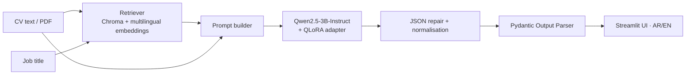

# 🎯 AI Resume-to-Interview Question Generator

An LLM application that reads a candidate's CV and a target job title, then generates **personalised technical interview questions** (with difficulty, skill tested, and a model answer). It combines three techniques:

| Technique | Role in this project |
|---|---|
| **RAG** | Retrieves reference interview questions and level criteria (Junior / Mid / Senior) from a vector database, so answers are grounded instead of guessed. |
| **Fine-tuning (QLoRA)** | Teaches the base model the exact output style: questions tied to the CV, graded difficulty, and a stable JSON structure. |
| **Output Parser** | Validates every model response against a Pydantic schema, so the UI always receives structured, trustworthy data. |

**Author:** _(write your name here)_  
**Supervisor:** _(write supervisor's name here)_

---

## Features

- Paste CV text or upload a **PDF** CV.
- **Bilingual**: Arabic (RTL) and English interface and output.
- Estimates the candidate level and returns 5 questions with skill, difficulty and model answer.
- Sidebar switches for **RAG on/off** and **fine-tuned model on/off**, which makes comparing the three variants live (base, +RAG, +RAG+fine-tuning) easy.
- Robust output handling: auto-repairs broken JSON, normalises values (e.g. `Intermediate` → `Mid`), drops truncated questions, and reports whether the output was valid on the first try.
- Results are shown as readable cards and can be downloaded as a text file.

## Architecture



## Tech stack

- **LLM:** Qwen2.5-3B-Instruct (fp16) with a LoRA/QLoRA adapter (PEFT)
- **Embeddings:** `sentence-transformers/paraphrase-multilingual-MiniLM-L12-v2` (Arabic + English)
- **Vector DB:** Chroma
- **Orchestration / parsing:** LangChain (`PydanticOutputParser`), Pydantic v2, `json-repair`
- **UI:** Streamlit

## Project structure

```
├── app.py                  # Streamlit app: retrieval, generation, parsing, UI
├── build_vectorstore.py    # Builds the Chroma knowledge base
├── knowledge/
│   └── knowledge.json      # RAG source: reference questions + level criteria
├── data/
│   └── seed_examples.json  # Hand-written examples used to start the fine-tuning dataset
├── requirements.txt
└── .gitignore
```

## Getting started

> A GPU is recommended (≈8 GB VRAM for the 3B model in fp16). The free **Kaggle T4** works well.

```bash
git clone https://github.com/<your-username>/ai-interview-question-generator.git
cd ai-interview-question-generator
pip install -r requirements.txt

python build_vectorstore.py      # creates chroma_db/
streamlit run app.py
```

If a folder named `qlora_adapter/` exists next to `app.py`, the app loads it automatically and enables the **fine-tuned model** switch.

**Running on Kaggle:** enable GPU + Internet, upload the project files, install the requirements, run `build_vectorstore.py`, then start Streamlit in the background and expose it with a temporary Cloudflare tunnel (`cloudflared tunnel --url http://localhost:8501`).

## How it works

1. **Retrieve:** the job title + CV are embedded and the top-3 most similar reference entries are fetched from Chroma.
2. **Prompt:** the CV, job, retrieved references and the requested output language are sent to the model with a strict system prompt.
3. **Generate:** the model returns JSON with `candidate_level` and a list of questions (`question`, `skill_tested`, `difficulty`, `ideal_answer`).
4. **Parse:** the response is repaired if needed, normalised, then validated by the Pydantic Output Parser. Invalid output is shown as an error with the raw text, never silently accepted.

## Fine-tuning

The adapter is trained with **QLoRA** (4-bit base + LoRA) on chat-formatted examples. Each example contains the CV, job, retrieved references and the target JSON answer, using exactly the same prompt format as the app. The dataset is built from:

- hand-written seed examples (`data/seed_examples.json`), and
- synthetic examples generated from real CVs (Kaggle *Resume Dataset*), validated against the same Pydantic schema, with a sample reviewed manually.

## Evaluation plan

The same set of CVs is run through three variants:

1. Base model
2. Base model + RAG
3. Base model + RAG + fine-tuning

| Metric | How it is measured |
|---|---|
| JSON validity rate | % of outputs valid on the first try (before repair) |
| CV relevance | Human rating (1-5) of how specifically each question refers to the CV |
| Question diversity | Number of distinct skills covered per candidate |

_Results table: to be added after the evaluation is completed._

## Project status

| Component | Status |
|---|---|
| RAG knowledge base + retrieval | ✅ Done |
| Pydantic Output Parser + repair/normalisation | ✅ Done |
| Streamlit UI (Arabic / English) | ✅ Done |
| Synthetic dataset generation | 🔄 In progress |
| QLoRA fine-tuning | ⏳ Planned |
| Three-way evaluation | ⏳ Planned |

## Limitations

- The knowledge base is small (19 entries) and focused on software / data roles; it should be extended for other fields.
- A 3B model can still produce generic questions or imperfect Arabic; answers should be reviewed by a human before real use.
- Synthetic training data inherits errors from the model that generated it, which is why a sample is reviewed manually.

---

## نبذة بالعربي

مشروع بياخد **السيرة الذاتية** و**المسمى الوظيفي** ويولّد أسئلة مقابلة مخصصة للمرشح، مع مستوى الصعوبة والمهارة والإجابة النموذجية. بيجمع بين:

- **RAG:** استرجاع أسئلة ومعايير مستويات من قاعدة بيانات متجهة.
- **Fine-tuning (QLoRA):** تعليم الموديل أسلوب الأسئلة وصيغة المخرجات.
- **Output Parser:** التحقق من مخرجات الموديل بـ Pydantic لضمان نتيجة منظمة.

الواجهة (Streamlit) تدعم **العربي والإنجليزي**، وفيها مفاتيح لتشغيل/إيقاف RAG والموديل المدرَّب للمقارنة المباشرة.
